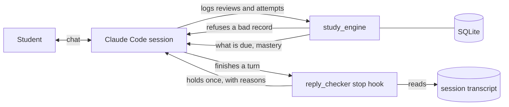

# Education Hub

A personal AI tutoring system built on Claude Code, shown here as two runnable parts: a study engine that refuses incomplete records, and a hook that holds a tutoring reply until it passes checks. The idea behind both is that a rule for an AI agent counts only when something enforces it and a test proves it.

Built by Arshawn Arbabi by directing Claude Code agents. I decided what to build, set the rules, used it, and sent back what was wrong, and the agents wrote the code.

The original vision for this Education Hub came during senior year of high school, where I wanted a way to integrate AI to keep track of all my assignments, tutor me, and accelerate my learning all while keeping track of my progress. But when I looked online, all the tools I found either had lots of manual work or didn't include all the features I wanted, and most of them were too expensive for me at the time anyway. This initial idea led me to build Cogni. I liked Cogni at first and I put emphasis on making sure it helped me think better rather than replacing my thinking, but I quickly realized that it wasn't dynamic enough for my learning, had lots of upkeep, and had no way to keep me on track, alongside having some fundamental problems that limited it from being something that I could really rely on and use daily to really benefit me. So I took the vision of Cogni and I evolved it into my full personal Education Hub. I kept what I liked about Cogni but made everything completely headless, so everything works through the Claude Code interface through the main Claude agent. Then I made learning and scheduling automatic: card reviews and practice problems happen right in the chat on a spaced repetition schedule, tutoring checks my work step by step, and deadlines turn into study blocks on my calendar with reminders on my phone. Each job became its own skill, like /education-system for tutoring, /process for filing anything I send it, /block for my calendar, /save for keeping records current, and /wire-in for making sure a new rule actually gets enforced. Next, I set up agents that run daily or as new files come in to gather all my data from Canvas, my school email, class recordings, handwritten notes, course readings, my homework site, and my clubs' Discord and Instagram to keep the system up to date and full of context. Lastly, I integrated all of this into a system that works automatically and for me. I've been using the Education Hub now for a few months and it's completely transformed my school experience in terms of productivity and staying on track. I regularly update and add new features, but if one feature disappeared right now, the one I'd miss the most is probably scheduling or the daily agents. Without scheduling, nothing due would have time set aside for it, and without the daily agents, I'd be back to checking Canvas, my email, and everything else myself.

This repo is the part I can share: a cut-down version of the study engine and the reply checker, with made-up sample data. The full system stays private because it holds my personal data and is tied to my own classes.

```
make demo    # sets up a local venv, installs one dependency, runs the tour. Needs Python 3.10+.
make test    # 110 tests
make prove   # removes each mechanism in turn and shows its test failing
```

## Try it with Claude Code

Paste this repo's link into [Claude Code](https://claude.com/claude-code). [`CLAUDE.md`](CLAUDE.md) tells it to run the demo, answer your questions from the code, and add a part to your own project only if you ask.

## What the demo shows

Real output, trimmed. All the data is made up: a fake course in the year 2030.

```
$ review card --rating 3
  REFUSED: confidence missing: give a 0 to 10 rating from before the key was seen, or state why there is none. Nothing was logged.
$ review card --rating 3 --no-confidence ""
  REFUSED: a reason for no confidence rating cannot be blank. Nothing was logged.
$ review card --rating 3 --confidence 7
  logged: {'rating': 'Good', 'correct': 1, 'confidence': 7}
```

And a tutoring reply that brings in a curve the student never mentioned. The Stop hook sends this back to the model, which fixes the reply before the person moves on:

```
{"decision": "block"}
Reply check. Fix each of these now, with a short correction of only that part:
- render: bare-number: $2$. Fix: rewrite the span so the chat renders it.
- no-picture: an explanation with no picture shown this turn. Fix: show a picture of this problem with the explanation, or declare: No picture: <reason>.
- made-up-example: a curve not in this problem: 2x. Fix: use this problem's own lines and numbers, or declare: Made-up example: <reason>.
```

## How it fits together



The session is the coach. The two parts are what keep it honest: one at the point it writes a record, and one at the point it finishes a reply.

## The three ideas

**1. Enforce at the point of writing.** `study_engine` uses real [FSRS](https://github.com/open-spaced-repetition/py-fsrs) scheduling and adds what a flashcard app does not keep: a confidence rating given before the key, and strict correctness stored apart from the scheduling rating. A write that breaks a rule stores nothing. Where a rule may not apply there is a declared way out, and a blank reason is refused. Mastery of a problem type is computed from attempts on every read, so it cannot go stale. See [`study_engine/store.py`](study_engine/store.py) and [`study_engine/mastery.py`](study_engine/mastery.py).

**2. Check the output, not the intent.** `reply_checker` reads the session transcript and runs rules over the reply. Curves are compared by value at sample points, so $x = 21 - y$ passes as a rewrite of $y = 21 - x$ and an invented $y = 2x$ does not. It holds a reply once and fails open with a log, so it cannot trap a session. See [`reply_checker/stop_hook.py`](reply_checker/stop_hook.py) and [`reply_checker/rules.py`](reply_checker/rules.py).

**3. Prove the tests can fail.** Each mechanism gets a planted violation, a compliant twin, a blank-reason case, and a mutant with the mechanism removed. [`tools/mutation_check.py`](tools/mutation_check.py) runs the mutants:

```
caught  review with no confidence rating  (ConfidenceRule)
caught  cold attempt with no rung  (RungRule)
caught  a miss does not reset the count  (SolidStatus)
caught  any use of 'the system' exempts a reply  (AboutTheTool)
caught  hook holds forever  (StopHook)
...
22 of 22 mutants caught.
```

The method is written up as a Claude Code skill in [`.claude/skills/wire-in/SKILL.md`](.claude/skills/wire-in/SKILL.md), which any agent can follow, and explained in [`docs/enforcement.md`](docs/enforcement.md).

## Read next

- [`docs/what-failed.md`](docs/what-failed.md): what went wrong and what changed. Start here if you only read one.
- [`docs/design.md`](docs/design.md): the decisions and what each one traded away.
- [`docs/enforcement.md`](docs/enforcement.md): what "enforced" means here, rule by rule.

## Numbers

Measured from this repo, 2026-11-01, on Python 3.14 on macOS, and checked from a clean clone. A test keeps the test and mutant counts in this file honest.

| | |
|---|---|
| Tests | 110 tests, standard library `unittest` |
| Mutants | 22 of 22 mutants caught |
| `study_engine` | 831 lines |
| `reply_checker` | 936 lines |
| Dependencies | one, `fsrs` |

## What this is not

- **Not the whole system.** This is a rewritten core with made-up data. The private system has more parts and many more rules, all tied to my own classes, and those hold personal data, so they stay private.
- **No claim about learning.** Nothing here measures whether this helps anyone learn, and the demo's numbers come from made-up data.
- **Not a product.** The reply rules are heuristics fit to one person's tutoring, and they will produce false holds. See the limits in [`docs/what-failed.md`](docs/what-failed.md).

## Where it came from

Education Hub is an evolution of [Cogni](https://github.com/arshawnarbabi/Cogni), my open source AI study app. Cogni is an app a student opens. Education Hub moved the work into the session where the tutoring already happens and put its rules into tools.

MIT licensed.
